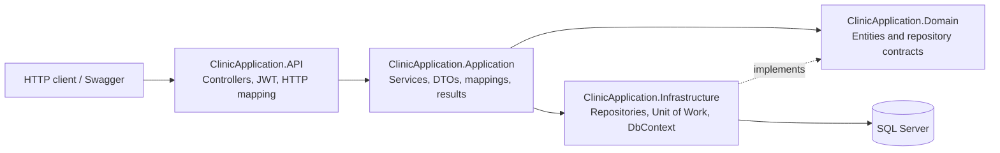
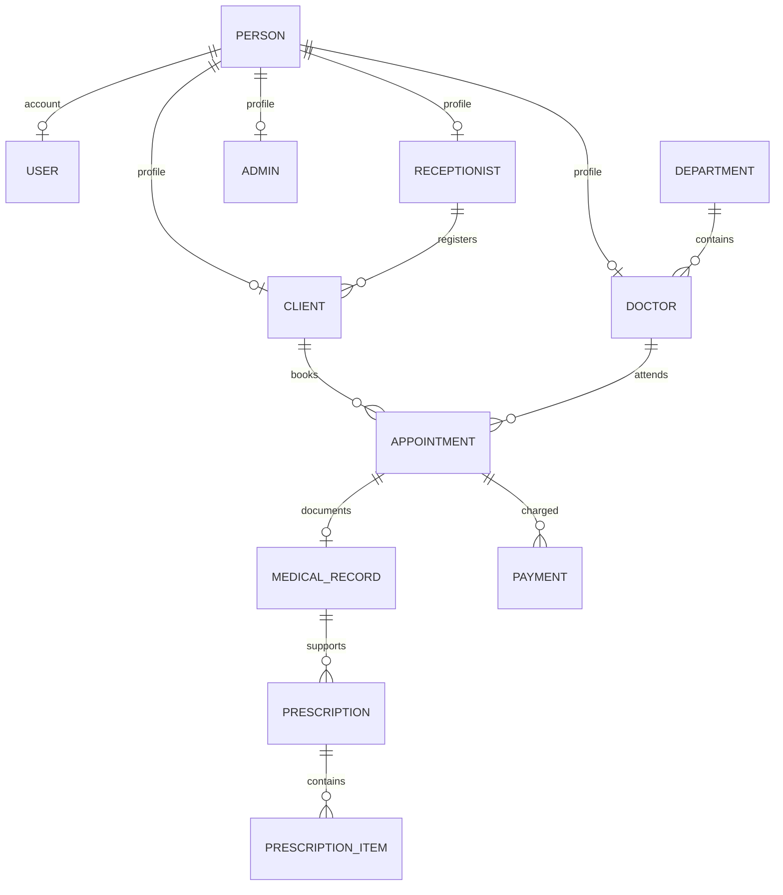

# ClinicApplication

ClinicApplication is an ASP.NET Core Web API for coordinating core clinic operations: staff and department administration, client registration, appointment scheduling, consultation records, prescriptions, payments, and client access to personal records.

## Version

**Current Version: v1.0.0**

This is the initial release and establishes the foundation of the clinic management system.

> ClinicApplication is currently at version v1.0.0. This initial release establishes the foundation of the clinic management system. Additional features, improvements, and enhancements are planned for future releases.

## Overview

The API supports four account roles: Admin, Receptionist, Doctor, and Client. Administrators maintain departments and staff, receptionists handle client intake, appointments, and payments, doctors manage their schedules and consultations, and clients can retrieve their own profile and clinical history. Requests pass from controllers through application services and repository interfaces to Entity Framework Core and SQL Server.

## Technology Stack

| Technology            | Verified implementation                                                         |
| --------------------- | ------------------------------------------------------------------------------- |
| C# / .NET             | .NET 8 (`net8.0`)                                                               |
| ASP.NET Core          | Web API, controller routing, authentication and authorization middleware        |
| Entity Framework Core | 8.0.0                                                                           |
| Database provider     | SQL Server (`Microsoft.EntityFrameworkCore.SqlServer` 8.0.0)                    |
| Authentication        | JWT Bearer; `Microsoft.AspNetCore.Authentication.JwtBearer` 8.0.31              |
| API documentation     | Swashbuckle.AspNetCore 6.6.2; Swagger UI enabled in Development                 |
| Other                 | Built-in dependency injection, LINQ, asynchronous service/repository operations |

## Architecture

The solution file includes four projects. The API references Application and Infrastructure; Application references Domain; Infrastructure implements persistence against Domain and Application abstractions



| Project                            | Responsibility                                                                                                                       |
| ---------------------------------- | ------------------------------------------------------------------------------------------------------------------------------------ |
| `ClinicApplication.API`            | ASP.NET Core startup, controller endpoints, JWT issuance/validation, password hashing, Swagger configuration, HTTP response mapping. |
| `ClinicApplication.Application`    | Use-case services and interfaces, DTOs, mapping extensions, and `Result` types for expected outcomes.                                |
| `ClinicApplication.Domain`         | Clinic entities, appointment status enum, and repository contracts.                                                                  |
| `ClinicApplication.Infrastructure` | EF Core `ClinicDbContext`, SQL Server configuration, repository implementations, and Unit of Work.                                   |

## Implemented Features

- **Authentication:** email/password login, JWT claims for user ID/email/role and password-change flag, current-user lookup, and authenticated password change.
- **Administration:** department creation/update/deletion and doctor transfers; doctor records can be associated with existing people and departments, moved, updated, and activated/deactivated. Receptionist records can be associated with existing people and managed. There is no endpoint in this solution for bootstrapping an initial Admin or creating the Person/account records required before doctor/receptionist registration.
- **Client intake:** receptionist creates a Person, Client, and User account in one transaction. A unique client code and temporary password are generated; the response includes the temporary password and the account requires password change. Receptionists can list, view, update, and reset client credentials.
- **Appointments:** receptionist schedules, lists, postpones, or cancels appointments. Doctors view their own schedule and complete their own appointments. Creation checks a future local time in `Asia/Amman`, active doctor status, referenced client/doctor, and occupied doctor slots.
- **Consultation records:** a doctor creates one MedicalRecord for an appointment they own, then may update it and create a Prescription with one or more medication items.
- **Payments:** receptionists record positive-amount payments against an appointment and can list an appointment's payments or all payments.
- **Client self-service:** clients can retrieve their own profile, appointments, medical records, and prescriptions.
- **Doctor history:** a doctor can retrieve a client's visit history when the doctor has at least one appointment with that client.

No notification, reminder, reporting, payment gateway, or appointment booking by the Client is implemented in the solution.

## Roles and Permissions

Permissions below reflect controller authorization attributes; service-level ownership checks further restrict some Doctor and Client requests.

| Role                   | Confirmed access                                                                                                                                                                                        |
| ---------------------- | ------------------------------------------------------------------------------------------------------------------------------------------------------------------------------------------------------- |
| Admin                  | Manage departments; create/update/move/activate doctors; create/update/activate receptionists; list doctors and departments.                                                                            |
| Receptionist           | Manage client intake and client accounts; manage appointments; list doctors and appointments; record and view payments; list departments.                                                               |
| Doctor                 | View own appointments, view only own appointment details, complete own appointments, create/update records for own appointments, prescribe against own records, and retrieve qualifying client history. |
| Client                 | Read own profile, appointments, appointment details, medical records, and prescriptions.                                                                                                                |
| Any authenticated role | Read departments, retrieve the authenticated account, and change its own password.                                                                                                                      |

## API Reference

All routes are relative to the API root. Controllers use `/api/[controller]`, except Payments (`/api/...`) and MedicalRecords (`/api/medical-records`). Every endpoint below is verified in the controllers.

| Method | Endpoint                                  | Description                                                                  | Required role        |
| ------ | ----------------------------------------- | ---------------------------------------------------------------------------- | -------------------- |
| POST   | `/api/auth/login`                         | Authenticate and issue a JWT.                                                | Anonymous            |
| POST   | `/api/auth/change-password`               | Change the authenticated user's password.                                    | Authenticated        |
| GET    | `/api/auth/me`                            | Retrieve authenticated account details.                                      | Authenticated        |
| GET    | `/api/departments`                        | List departments.                                                            | Authenticated        |
| POST   | `/api/departments`                        | Create department.                                                           | Admin                |
| PUT    | `/api/departments/{id}`                   | Update department.                                                           | Admin                |
| DELETE | `/api/departments/{id}`                   | Delete department if it has no doctors.                                      | Admin                |
| POST   | `/api/departments/{id}/transfer-doctors`  | Transfer department doctors to another department.                           | Admin                |
| GET    | `/api/doctors`                            | List doctors.                                                                | Admin, Receptionist  |
| GET    | `/api/doctors/{id}`                       | Get doctor by ID.                                                            | Admin, Receptionist  |
| POST   | `/api/doctors`                            | Register an existing Person as a doctor in a department.                     | Admin                |
| PUT    | `/api/doctors/{id}`                       | Update doctor department/specialization.                                     | Admin                |
| PUT    | `/api/doctors/{id}/department`            | Move doctor to another department.                                           | Admin                |
| PATCH  | `/api/doctors/{id}/status`                | Activate/deactivate doctor.                                                  | Admin                |
| GET    | `/api/doctors/me/appointments`            | List own appointments; optional `date` and `status` filters.                 | Doctor               |
| GET    | `/api/receptionists`                      | List receptionists.                                                          | Admin                |
| POST   | `/api/receptionists`                      | Register an existing Person as a receptionist.                               | Admin                |
| PUT    | `/api/receptionists/{id}`                 | Update receptionist personal details.                                        | Admin                |
| PATCH  | `/api/receptionists/{id}/status`          | Activate/deactivate receptionist account.                                    | Admin                |
| GET    | `/api/clients`                            | List clients.                                                                | Receptionist         |
| GET    | `/api/clients/{id}`                       | Get client by ID.                                                            | Receptionist         |
| GET    | `/api/clients/by-code/{clientCode}`       | Get client by client code.                                                   | Receptionist         |
| POST   | `/api/clients`                            | Register client and linked account; returns generated temporary credentials. | Receptionist         |
| PUT    | `/api/clients/{id}`                       | Update client personal details.                                              | Receptionist         |
| POST   | `/api/clients/{id}/reset-password`        | Generate a replacement temporary password.                                   | Receptionist         |
| GET    | `/api/clients/{id}/history`               | Get visits, records, and prescriptions if this doctor has seen the client.   | Doctor               |
| GET    | `/api/appointments`                       | List appointments ordered by date/time.                                      | Receptionist         |
| GET    | `/api/appointments/{id}`                  | Get appointment; a doctor is limited to their own.                           | Receptionist, Doctor |
| POST   | `/api/appointments`                       | Create appointment.                                                          | Receptionist         |
| PUT    | `/api/appointments/{id}/postpone`         | Change appointment time and record reason.                                   | Receptionist         |
| PUT    | `/api/appointments/{id}/cancel`           | Cancel appointment.                                                          | Receptionist         |
| PUT    | `/api/appointments/{id}/complete`         | Complete own appointment.                                                    | Doctor               |
| POST   | `/api/appointments/{id}/medical-record`   | Create a record for own appointment.                                         | Doctor               |
| PUT    | `/api/medical-records/{id}`               | Update own medical record.                                                   | Doctor               |
| POST   | `/api/medical-records/{id}/prescriptions` | Add prescription and medication items to own record.                         | Doctor               |
| POST   | `/api/appointments/{id}/payments`         | Register payment against appointment.                                        | Receptionist         |
| GET    | `/api/appointments/{id}/payments`         | List payments for appointment.                                               | Receptionist         |
| GET    | `/api/payments`                           | List all payments.                                                           | Receptionist         |
| GET    | `/api/me/profile`                         | Get own client profile.                                                      | Client               |
| GET    | `/api/me/appointments`                    | List own appointments.                                                       | Client               |
| GET    | `/api/me/appointments/{id}`               | Get an own appointment.                                                      | Client               |
| GET    | `/api/me/medical-records`                 | List own medical records.                                                    | Client               |
| GET    | `/api/me/prescriptions`                   | List own prescriptions and items.                                            | Client               |

## Database Overview

`ClinicDbContext` maps the clinic entities to SQL Server tables. Important verified relationships are:

- `User` and each role record reference a `Person` through `PersonId`; `Person` has optional one-to-one navigation to User, Admin, Client, Doctor, and Receptionist. A Client registration transaction creates Person, Client, and User together. Doctor and Receptionist registration endpoints only attach an already-existing Person and do not create an account.
- `Doctor` belongs to one `Department`; a department has many doctors. Doctor and Receptionist rows record the creating Admin.
- `Client` belongs to the receptionist who registered it. A Client has many appointments.
- Each `Appointment` references one Client and one Doctor, and may have a receptionist recorded as updater. The database has a unique doctor/date-time index filtered to exclude cancelled appointments.
- `MedicalRecord` references exactly one Appointment (unique `AppointmentId`); an appointment may have at most one record.
- `Payment` references an Appointment, not Client directly. An appointment has many payments.
- `Prescription` references a MedicalRecord; each prescription has many `PrescriptionItem` rows. There is no direct Doctor or Client foreign key on Prescription; those are reached through MedicalRecord → Appointment.



## Authentication and Authorization

`POST /api/auth/login` verifies the email and password hash and refuses inactive accounts. The API maps stored role values `0–3` to Client, Doctor, Receptionist, and Admin, then issues a signed JWT containing the user ID (`NameIdentifier`), email, role, and `mustChangePassword`. Bearer validation checks issuer, audience, lifetime, and signing key. Send the token as `Authorization: Bearer <token>`.

Controllers use `[Authorize]` and `[Authorize(Roles = ...)]`. For ownership-sensitive operations, the controller reads the user ID claim and the application/repository resolves the associated role entity and filters by its ID. Client self-service queries are scoped through the authenticated user's linked Person/Client. The first-party client registration flow sets `MustChangePassword`; the application exposes authenticated password change. No refresh-token flow is present.

## Installation and Setup

Requirements verified from project configuration:

- .NET 8 SDK
- SQL Server instance accessible to the API
- A configured database matching the `ClinicDbContext` model

The checked-in API settings show a local SQL Server default and JWT issuer/audience/expiry settings. Do not store a real JWT signing key in source control. Configure the following values using .NET User Secrets or environment variables (environment-variable names use double underscores):

```text
ConnectionStrings__DefaultConnection=<SQL Server connection string>
Jwt__Key=<at least 32 UTF-8 bytes of secret key material>
Jwt__Issuer=<issuer>
Jwt__Audience=<audience>
Jwt__ExpirationMinutes=60
```

The startup code requires a JWT key of at least 32 UTF-8 bytes plus issuer and audience. EF Core is configured for SQL Server. No migrations or automated test projects are present in the solution, and the repository does not document a database bootstrap/seed process. The current `ClinicDbContext.OnConfiguring` also contains a local connection-string fallback, so review that source configuration before using a different environment; the value is intentionally not reproduced here.

From the solution root:

```powershell
dotnet restore .\ClinicApplication.slnx
dotnet build .\ClinicApplication.slnx
dotnet run --project .\ClinicApplication.API\ClinicApplication.API.csproj
```

Swagger UI is registered only when the environment is Development. HTTPS redirection is enabled.

## Project Structure

```text
ClinicApplication/
├── ClinicApplication.slnx
├── ClinicApplication.API/
│   ├── Controllers/
│   ├── Services/                 # JWT and password hashing
│   ├── Program.cs
│   └── appsettings*.json
├── ClinicApplication.Application/
│   ├── DTOs/
│   ├── Interfaces/Services/
│   ├── Mappings/
│   └── Services/
├── ClinicApplication.Domain/
│   ├── Entities/
│   ├── Enums/
│   └── Interfaces/Repositories/
└── ClinicApplication.Infrastructure/
    ├── Persistence/Data/          # ClinicDbContext
    ├── Persistence/Repositories/
    ├── DependencyInjection.cs
    └── UnitOfWork/
```

The repository also contains a separate `Clinic-System-API/` tree that is not referenced by `ClinicApplication.slnx`; it is not part of the documented build architecture.

## Roadmap — Upcoming Features

### Implemented in v1.0.0

Authentication and role authorization, staff/department management, receptionist-led client registration, appointment scheduling and status handling, doctor-owned medical records and prescriptions, appointment-linked payments, and client self-service reads are implemented as described above.

### Potential Future Enhancements

These are suggestions for consideration, not approved commitments:

- Bootstrap/seed and account provisioning workflows for administrative and clinical staff.
- Appointment search, richer availability rules, and client-initiated booking.
- Notifications and appointment reminders.
- Reporting and operational analytics.
- Payment reconciliation or payment-provider integration.
- Audit logging, broader automated tests, and security configuration hardening.
- Performance optimization and pagination for collection endpoints.

## Documentation

See [docs/PROJECT_FLOW.md](docs/PROJECT_FLOW.md) for a scenario-driven explanation of the system's operational workflow and request processing.

## Project Status

- **Current version:** v1.0.0
- **Status:** Initial release / ongoing development
- **Future enhancements:** Under consideration; the project is expected to evolve over time.
